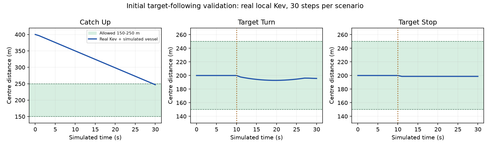

# 动态目标追踪初步测试（2026-10-28）

实现和任务语义见 [动态追踪说明](../../../navigation/TARGET_FOLLOWING.md)，任务样例见 [target_following.json](../../../examples/target_following.json)。

## 自动化测试

- 服务端：`PYTHONPATH=jev_api:. python3 -m unittest discover -s server/tests -q`，**211 项通过**，包括新增 17 项动态追踪测试。日志：[server-tests.log](server-tests.log)。
- 专项覆盖：参数与目标新鲜度、单位转换、相对扫掠预测、低速匹配、超距恢复、目标停车、静态避碰、初始航向、目标丢失／恢复和显式停止。
- 本地 UDP 集成测试使用模拟模型和临时回环端口，验证 `0x0660 → 0x0060 → 0x0662 → 0x0666 → 0x0664`，确认进入区间后仍持续控制，收到停止请求并确认实际零速后才完成。
- `python3 server/decision_service.py --help` 和 `git diff --check` 通过。
- 额外执行既有 `jev_api/tests`：17 项中 8 项通过、9 项因缺少 `Assets/StreamingAssets/fixed_route.json` 等 Unity 地图夹具报错。这些测试及目录未在本次修改；未把缺少夹具标记为通过。日志：[api-tests.log](api-tests.log)。

## 真实 Kev 闭环

本机 RTX 5090、项目 `.venv-kev` 与现有 `models/kev-4b-local`，临时回环端口启动官方模型服务。每场景 30 个模拟秒、1 秒控制动作；目标初速 10 节，允许距离为 150–250 米。转向／停车事件发生在第 10 秒。模型实际 HTTP 请求全部成功；测试服务结束后已关闭。

| 场景 | 初始距离 | 最终距离 | 最小距离 | 区间内采样比例 | 最终航速 | 最慢决策 |
| --- | ---: | ---: | ---: | ---: | ---: | ---: |
| 超距追赶 | 400.00 m | 246.95 m | 246.95 m | 3.3% | 20.00 节 | 1.96 s |
| 目标转向90度 | 200.00 m | 195.69 m | 192.86 m | 100.0% | 5.00 节 | 2.27 s |
| 目标停车 | 200.00 m | 198.71 m | 198.71 m | 100.0% | 0.00 节 | 2.27 s |

三组均未低于150米下限，也未进入无安全候选等待。追赶在第30秒末进入区间，尚未覆盖入圈后的长期稳定性；转向及停车场景全程处于区间内，目标停车后本艇最终为零速。完整轨迹和时延：[kev.json](kev.json)。



## 模拟模型闭环

采用确定性候选选择夹具替代模型，其他追踪预测和安全检查仍执行。三场景各60个模拟秒，事件发生在第20秒；用来验证代码链路，不评价真实模型。

| 场景 | 最终距离 | 最小距离 | 区间内采样比例 | 最终航速 |
| --- | ---: | ---: | ---: | ---: |
| 超距追赶 | 200.31 m | 200.31 m | 81.7% | 10.00 节 |
| 目标转向90度 | 185.48 m | 182.71 m | 100.0% | 10.00 节 |
| 目标停车 | 198.71 m | 198.71 m | 100.0% | 0.00 节 |

完整记录：[mock.json](mock.json)。

## 复现与边界

```bash
PYTHONPATH=jev_api:. python3 -m server.experiments.target_following --mock --steps 60 --output /tmp/following-mock.json
# 先单独启动真实 Kev，再执行：
PYTHONPATH=jev_api:. .venv-kev/bin/python -m server.experiments.target_following --steps 30 --output /tmp/following-kev.json
```

两艇运动由独立的0.02秒中点积分更新，并对动作内部距离采样；本艇使用配置的0.5秒速度响应和45度/秒转向近似。目标当前速度匀速预测与突然转向／停车的场景切换不等于真实船体动力学。

真实模型串行决策耗时可超过1秒控制周期；上述闭环每次决策后推进1秒模拟时间，未模拟推理期间真实艇持续运动的延迟。公共异步发送／续发由自动化测试覆盖，仍需更长时段、真实模型异步UDP闭环和实艇验证。复杂静态障碍路径、迎面紧急逃逸、极端速度差及长时间丢失并不在这三组场景的效果结论内。测试未向现场地址发送控制报文。
