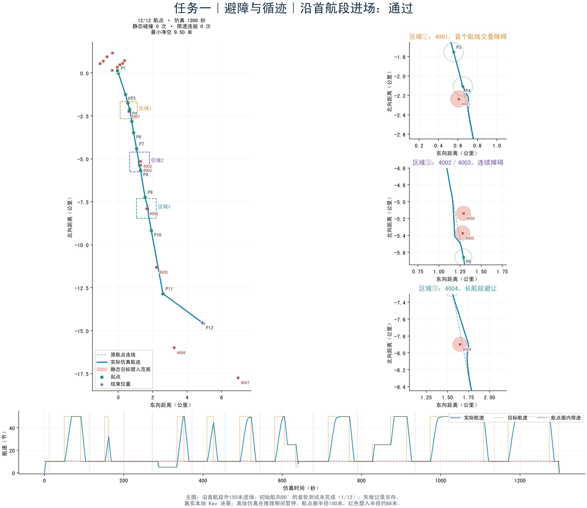
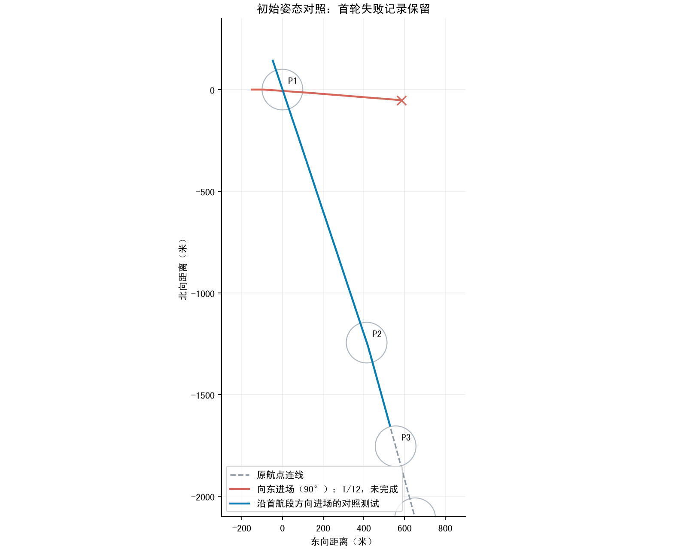

# 任务一：避障与循迹测试

真实本地 Kev 模型，离线仿真。原地图12个航点、16个静态目标，参考航线约16.04公里。

| 测试 | 航点 | 完成 | 通过 | 原因 |
|---|---:|---|---|---|
| 首航点以西150米、初始航向90° | 1/12 | False | False | navigation_no_progress |
| 沿首航段反向延长线150米、初始航向沿首航段 | 12/12 | True | True | completed |

主测试静态碰撞：0；航点限速违规：0；最小静态净空：9.500米；停车确认：True。

主测试仿真1300秒，最高实际航速50.000节，最大实际平均转向角速度7.796°/s。

首轮失败详情：航点1低速恢复连续20轮无改善；距离1203.9米，航向误差93.8度

主测试异常：None

当前参数：最大50节、加速度1.46m/s²、制动幅值1.75m/s²、转向角速度12°/s、角加速度4°/s²。50节直线加速使用实测控制器响应。

首轮失败和主测试结果分别保留，不能把对照测试通过解释为任意初始姿态均通过。此图基于航点与目标坐标层，不包含岸线／水深；世界在模型推理期间暂停。

运动指令回放与原航迹匹配；源文件哈希一致。加速度、制动、角速度及角加速度约束检查通过。
实测50节加速响应在本次实际运动中触发171个控制周期；重算最小静态净空9.500米。
