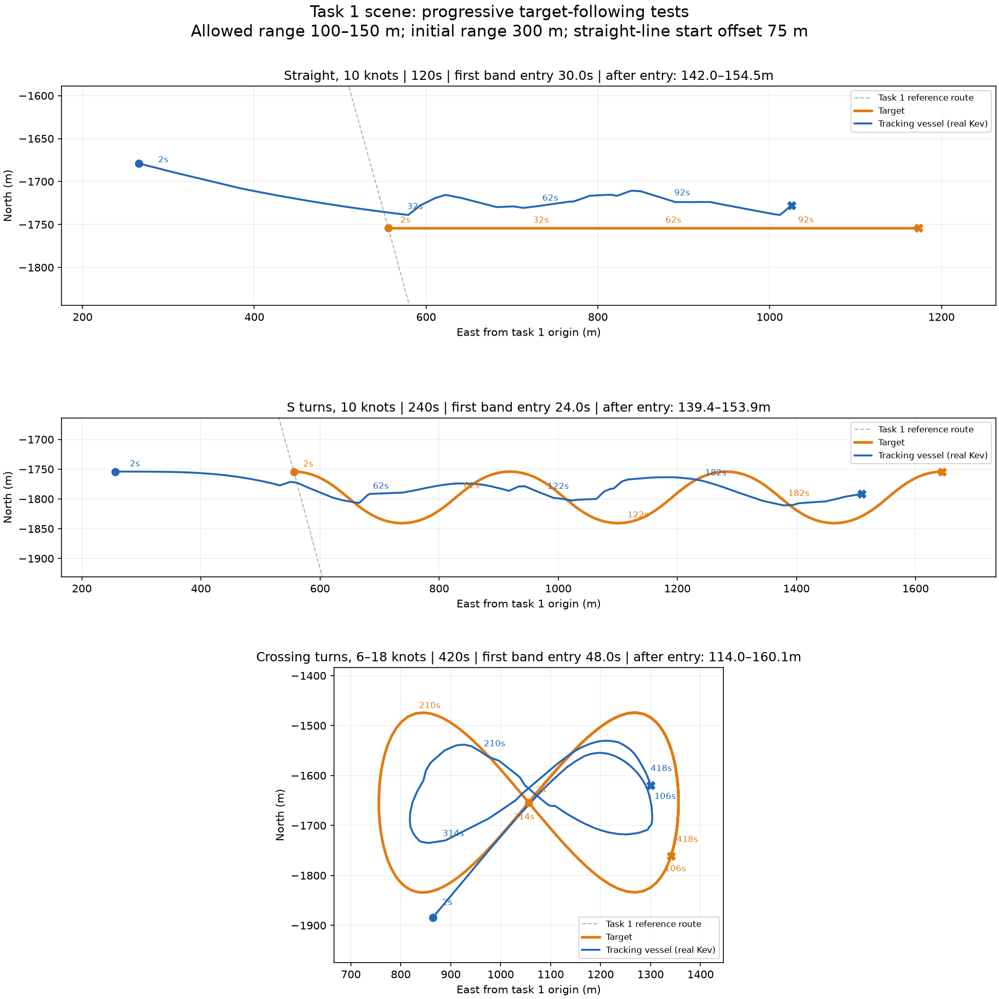

# 任务一地图目标追踪测试结果

三种路线均调用当前运行的真实本地 Kev 服务，未用模拟选择器替代。允许中心距离 **100–150米**，每种初始距离 **300米**；直线场景本艇起点侧向偏离目标运动直线 **75米**。配置由任务样例读取，各场景保存了当次任务快照。

## 结果

| 场景 | 模拟时长 | 首次入圈 | 入圈后控制采样距离 | 入圈后区间内比例 | 最终距离 | 安全等待次数 |
| --- | ---: | ---: | ---: | ---: | ---: | ---: |
| 匀速直线 | 120s | 30s | 141.99–154.45m | 67.4% | 150.04m | 0 |
| S形 | 240s | 24s | 139.37–153.91m | 73.4% | 139.86m | 0 |
| 交叉折返与变速 | 420s | 48s | 114.03–160.11m | 77.5% | 147.06m | 0 |

首次入圈和入圈后统计按2秒控制采样点计算；各场景 `summary.json` 另含0.02秒积分采样得到的全程最小距离与全程区间内比例。初始300米在允许范围以外，是有意设置的追赶条件；不能把初始超距直接当作跟踪失败。

## 分场景图像与记录

- **匀速直线**：[完整路线／距离／速度图](straight/routes.png) · [统计](straight/summary.json) · [逐轮轨迹](straight/trajectory.jsonl)。
- **S形**：[完整路线／距离／速度图](s_curve/routes.png) · [统计](s_curve/summary.json) · [逐轮轨迹](s_curve/trajectory.jsonl)。
- **交叉折返与变速**：[完整路线／距离／速度图](crossing_variable/routes.png) · [统计](crossing_variable/summary.json) · [逐轮轨迹](crossing_variable/trajectory.jsonl)。

交叉场景目标沿8字路线完成约 **1.30圈**，控制采样目标速度范围 **6.01–17.99节**。其目标最大转向角速度预检约8.93度/秒，速度变化率约0.194米/秒²，目标位置和速度连续变化，无瞬移。

## 观察与限制

直线和S形均能从超距状态追回，但入圈后存在短暂超过150米、反复切换速度的现象。当前结果说明具备追赶能力，尚不能认定稳定维持距离区间。

- 匀速直线：全程最小中心距离141.31米；本艇到记录静态安全圈的最小净距412.04米；目标对应净距396.11米；最长决策2.86秒；速度指令变化31次。
- S形：全程最小中心距离139.33米；本艇到记录静态安全圈的最小净距347.07米；目标对应净距326.06米；最长决策2.89秒；速度指令变化65次。
- 交叉折返与变速：全程最小中心距离113.95米；本艇到记录静态安全圈的最小净距348.36米；目标对应净距372.64米；最长决策3.71秒；速度指令变化113次。

所有16个记录静态目标均参与检查，但目标路线预留了较大静态净距，本组主要评估移动目标追踪。追踪目标是两艇中心距离区间，轨迹无需逐点重合。

地图数据为任务一原始12个航点及记录障碍物，没有海岸线、水深或完整Unity地形。船舶按0.5秒速度响应、45度/秒转向上限，用独立0.02秒中点积分更新。模型推理期间暂停模拟时间，未覆盖真实推理延迟下的实时船舶运动，不代表实艇验证。未向现场发送控制报文。

实验说明与复现命令见 [README.md](README.md)。旧范围或旧共线起点结果已保留为历史记录，不计入本报告。

[动图与交互回放说明](REPLAY.md)：[直线动图](straight/replay.gif) · [S形动图](s_curve/replay.gif) · [交叉变速动图](crossing_variable/replay.gif)。
