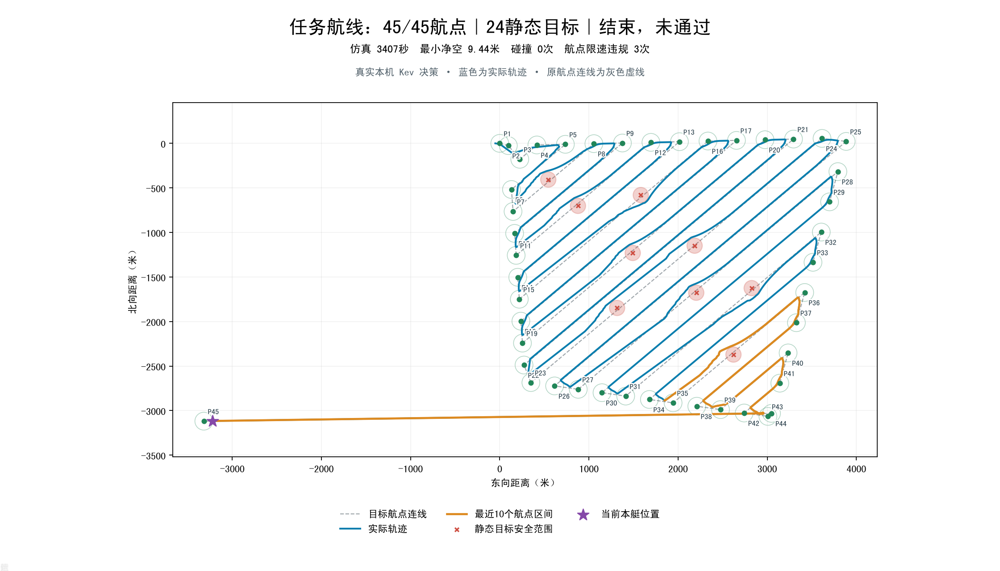
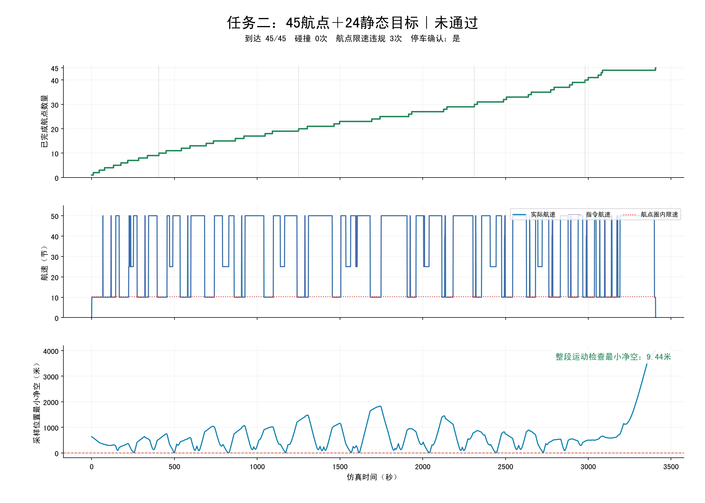

# 任务二追加障碍物闭环测试（2026-10-28）

上次停止于23/45航点的临时记录已清理，本次无法恢复当时的精确状态，故使用当前代码从头完整重跑。
保留原45航点与16个静态目标，精确重建上次8个新增目标的位置，共24个。未修改航点或避障参数以迎合测试结果。

| 指标 | 结果 |
| --- | --- |
| 总体通过 | 否 |
| 完成航点 | 45/45 |
| 静态目标数量 | 24 |
| 碰撞次数 | 0 |
| 全程最小净空 | 9.441米 |
| 航点限速违规 | 3 |
| 实际最大转向速率 | 45.00度/秒 |
| 停车确认 | True |
| 最终航速 | 0.00节 |
| 仿真时长 | 3407秒 |
| 本机运行时间 | 1986.8秒 |
| 结束原因 | completed |
| 错误 | None |

## 每十航点阶段图

| 已完成航点 | 仿真时刻 | 累计最小净空 | 碰撞次数 | 航点限速违规 | 图像 |
| --- | --- | --- | --- | --- | --- |
| 10 | 406秒 | 10.037米 | 0 | 0 | [查看](checkpoints/waypoints_10.png) |
| 20 | 1250秒 | 9.441米 | 0 | 0 | [查看](checkpoints/waypoints_20.png) |
| 30 | 2312秒 | 9.441米 | 0 | 0 | [查看](checkpoints/waypoints_30.png) |
| 40 | 2980秒 | 9.441米 | 0 | 0 | [查看](checkpoints/waypoints_40.png) |





默认起点在首航点西侧50米，处于100米到达圈内，第1个航点初始化计为到达。
净空为中心间距扣除约86.04米安全中心距离后的余量。最小值检查每步运动路径的全部线段；曲线展示逐秒采样位置净空。
本机真实 Kev 决策，仿真使用配置的速度响应和转向速率；推理期间暂停仿真时间，未加入风流、侧滑和完整船体水动力。没有向现场发送任务或控制报文。

## 复现命令

从项目根目录运行：

```bash
.venv-kev/bin/python server/local_models/serve_kev.py --device cuda
.venv/bin/python server/experiments/field_tasks.py --task two --steps 12000 --checkpoint-every 10 --static-situation server/experiments/results/task-two-augmented-20261028/static-situation-augmented.json --output /tmp/kev-task-two-repeat
```

## 未通过原因：返程重新进入已访问航点圈时减速过晚

| 仿真时刻 | 航点 | 圈内峰值航速 | 圈内限速 |
| --- | --- | --- | --- |
| 3101秒 | P42 | 50.00节 | 10.289节 |
| 3143秒 | P39 | 50.00节 | 10.289节 |
| 3178秒 | P38 | 50.00节 | 10.289节 |

三次均发生在已完成44个航点、驶向终点的返程阶段。前一轮决策仍为巡航50节；记录到进入旧航点圈后，速度阶段才切换为 exit_circle 并下发10节。因此不是碰撞或模型超时，而是再次进圈的限速提前量不足。
结论：completed=true、passed=false、stop_confirmed=true。
